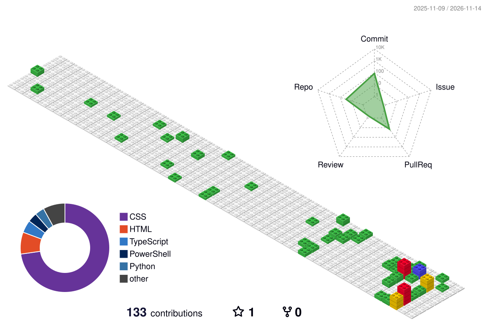
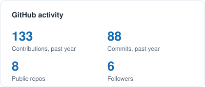
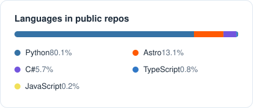

&nbsp;

&emsp;&emsp;

<picture>
  <source media="(prefers-color-scheme: dark)" srcset="https://raw.githubusercontent.com/Thebearcoding/Thebearcoding/output/github-snake-dark.svg" />
  <source media="(prefers-color-scheme: light)" srcset="https://raw.githubusercontent.com/Thebearcoding/Thebearcoding/output/github-snake.svg" />
  
</picture>

# 🙋 Hello

<table>

<tr><td>

### 🐻 About Me

嗨，我是 Xinran Xiong，也叫 athebear。方向是多模态与 Agent，目前的重点是 **Coding Agent / Agent Harness**：读 harness 源码，在本地把它们跑起来，给开源项目做贡献。

平时也喜欢摄影。

</td></tr>

<tr><td>

### 🤝 Contributor

[BaoCode](https://github.com/baocode-dev/baocode) · [openfilm](https://github.com/openfilm/openfilm) · [FlashRAG](https://github.com/RUC-NLPIR/FlashRAG) · [karaoke](https://github.com/Trinkle23897/karaoke) · [a7c2-fl23-research](https://github.com/QAQLeonard/a7c2-fl23-research)

</td></tr>

<tr><td>

### 🔬 读 harness：learn-claude-code 精读（17 篇）

从一个 `while` 循环读到工具、权限、hooks、子 Agent、上下文压缩、记忆、任务图、后台任务、定时任务、多 Agent 团队、MCP、workflow 和 goal loop。每课逐段读 `code.py`，并在本地通过代理接真实模型跑一次，记录跑起来才看得到的现象，比如：

- 上下文压缩从没触发摘要，旧结果被换成路径后模型反复重读，24 次请求发出 90 万字符
- 后台命令早已跑完，结果却要等用户下一句话才被看到
- 多 Agent 时 Lead 答应用 worktree，实际没有创建
- 三个审查维度各自报出同一个 SQL 注入，流程里没有去重

👉 [从第一篇开始读](https://athebear.me/notes/lcc-s01-agent-loop/)

原文转载自 shareAI-lab/learn-claude-code；导读、真实运行记录和参考答案由 Claude Code 撰写，我用它系统地过一遍这些机制。

</td></tr>

<tr><td>

### 🛠️ 正在做

**自己的 coding agent harness**：参考 BaoCode 和 DeepSeek Harness 的设计，按「模型循环 → 工具协议 → 上下文 → 权限与取消 → 会话恢复」一块一块地实现。还在早期，做出能演示的版本后再公开。

</td></tr>

<tr><td>

### 📃 最近的笔记

<!-- BLOG-POST-LIST:START -->
- [learn-claude-code s17：Goal Loop，没达标就别停](https://athebear.me/notes/lcc-s17-goal-loop/)
- [learn-claude-code s16：Workflow Runtime，把固定流程写成能续跑的脚本](https://athebear.me/notes/lcc-s16-workflow-runtime/)
- [learn-claude-code s15：Integrated Harness，十几种机制挂在同一个循环上](https://athebear.me/notes/lcc-s15-integrated-harness/)
- [learn-claude-code s14：MCP Tools，工具不再写死在代码里](https://athebear.me/notes/lcc-s14-mcp-plugin/)
- [learn-claude-code s13：Agent Teams，一个 Lead 带几个常驻队友](https://athebear.me/notes/lcc-s13-agent-teams/)
<!-- BLOG-POST-LIST:END -->

</td></tr>

</table>

### 🧰 日常

开发时用 Claude Code、Codex、Cursor。

&nbsp;

<picture>
  <source media="(prefers-color-scheme: dark)" srcset="https://raw.githubusercontent.com/Thebearcoding/Thebearcoding/output/contrib-3d-dark.svg" />
  <source media="(prefers-color-scheme: light)" srcset="https://raw.githubusercontent.com/Thebearcoding/Thebearcoding/output/contrib-3d-light.svg" />
  
</picture>

<table>
  <tr>
    <td>
      <picture>
        <source media="(prefers-color-scheme: dark)" srcset="https://raw.githubusercontent.com/Thebearcoding/Thebearcoding/output/stats-dark.svg" />
        <source media="(prefers-color-scheme: light)" srcset="https://raw.githubusercontent.com/Thebearcoding/Thebearcoding/output/stats-light.svg" />
        
      </picture>
    </td>
    <td>
      <picture>
        <source media="(prefers-color-scheme: dark)" srcset="https://raw.githubusercontent.com/Thebearcoding/Thebearcoding/output/languages-dark.svg" />
        <source media="(prefers-color-scheme: light)" srcset="https://raw.githubusercontent.com/Thebearcoding/Thebearcoding/output/languages-light.svg" />
        
      </picture>
    </td>
  </tr>
</table>

